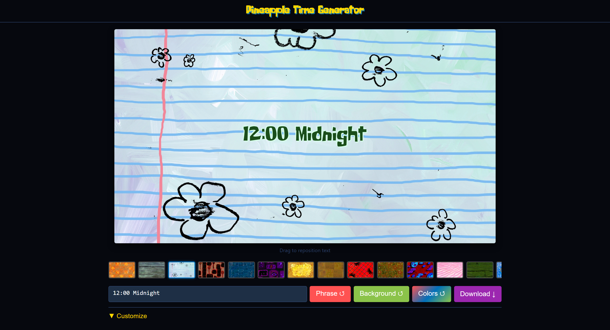

# Pineapple Time Generator

[](https://memoriainfinita.github.io/PineappleTimeGenerator/)
[](LICENSE)

SpongeBob-themed time card generator. Create title cards in the style of the show's iconic scene transitions and export them as clean PNGs for video editing.



## Quick Start

**Online:** [Open Pineapple Time Generator](https://memoriainfinita.github.io/PineappleTimeGenerator/) — no install needed, ready to use.

**Local:** the app must be served over http (opening `index.html` directly via `file://` breaks PNG export). Clone and start a simple server:
```bash
git clone https://github.com/memoriainfinita/PineappleTimeGenerator.git
cd PineappleTimeGenerator
python -m http.server
```
Then open `http://localhost:8000`.

## Features

- **Text:** write your own or pick from 35+ iconic phrases with `Phrase ↺`; loads a random one on start
- **Backgrounds:** 15 SpongeBob episode backgrounds + custom image upload; loads a random one on start, or pick one at random with `Background ↺`
- **Smart colors:** `Colors ↺` analyzes background brightness and picks readable text/shadow colors
- **Style:** font size (+/− buttons or slider), text color, shadow color
- **Positioning:** drag text directly on the card; alignment buttons (L/C/R) and reset
- **Aspect ratio:** toggle between 16:9 and 4:3
- **Favorites:** save, load, delete presets; export/import as JSON
- **Export:** clean PNG at 2× resolution (no UI chrome)

## How to Use

1. Write your text or click `Phrase ↺` for a random one
2. Choose a background from the strip, upload your own, or click `Background ↺` for a random one
3. Click `Colors ↺` to auto-set readable colors, or adjust manually
4. Drag the text on the card to reposition it
5. Save as a favorite if you want to reuse this setup
6. Click `Download ↓` to export as PNG

**Keyboard shortcut:** `Ctrl+S` opens the panel and focuses the favorites name field.

## Special Dedication

This project is dedicated to **[CuriousMarc](https://www.youtube.com/c/Curiousmarc)** — a YouTube channel I've been watching for years. They use SpongeBob time cards throughout their videos on vintage computing and electronics restoration. *Merci beaucoup* to Marc and his team.

## Technologies

- HTML5 / CSS3 / JavaScript (vanilla)
- [html2canvas](https://html2canvas.hertzen.com/) for image export

## Development

Three files (`index.html`, `style.css`, `app.js`), no build step.

## License

GPL-3.0 — free to use, modify, and distribute. Derivatives must also be GPL-3.0.

## Credits

Developed by [@memoriainfinita](https://github.com/memoriainfinita) with the assistance of Claude (Anthropic): Opus 4.8 and Sonnet 4.6.
