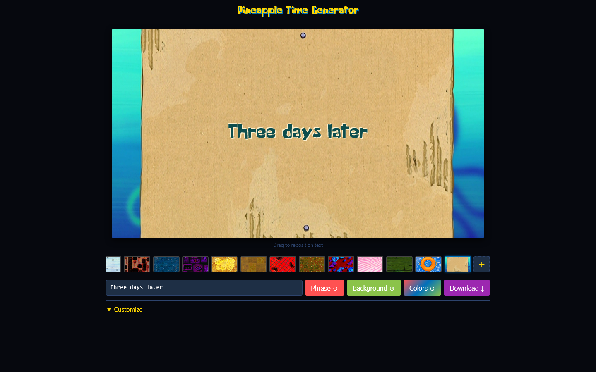
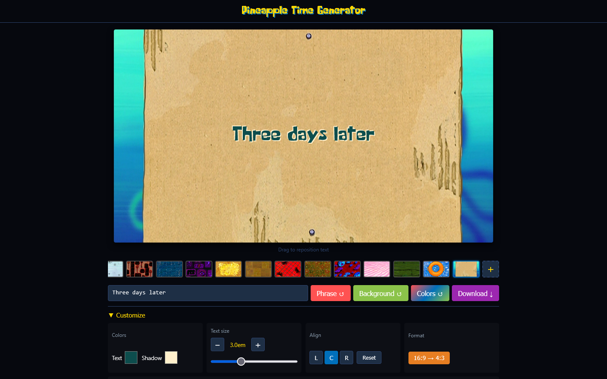

# Pineapple Time Generator guide

How to make a time card. The [README](../../README.md) lists the features; this page is a short walk through.

Open https://memoriainfinita.github.io/PineappleTimeGenerator/. Everything happens in your browser. If you run it yourself, serve it over http (`python -m http.server`): from `file://` the PNG export breaks (a transparent PNG still works).

## Make a card

The page starts with a random phrase over a random background. Then:

1. **Write your text** in the box under the card, or press **Phrase ↺** for one of the 35 or more iconic phrases
2. **Choose a background** from the strip below the card, press **Background ↺** for a random one, or press **+** at the start of the strip to upload an image of your own
3. Press **Colors ↺**: it looks at the part of the background behind the text and picks a text colour and a shadow colour that read well on it
4. **Drag the text** on the card to place it, or focus the card and use the arrow keys (Shift moves it further)
5. Press **Download ↓** to get a PNG with none of the page around it, at a fixed size: 1920×1080 for 16:9, 1440×1080 for 4:3, 1080×1920 for 9:16 and 1080×1080 for 1:1

Your own backgrounds stay in the browser. The strip keeps up to five: a sixth replaces the oldest one, and the ✕ on one of yours removes it.

## Customize

**▼ Customize** opens a panel under the controls; Esc closes it.

- **Colors**: the text and the shadow, by hand, and whether the text gets a **Shadow** or an **Outline**
- **Text size**: the − and + buttons or the slider
- **Align**: L, C or R, which you see on text of several lines (Enter in the box makes a new line); **Reset** puts the text back in the centre
- **Format**: the aspect ratio of the card (16:9, 4:3, 9:16 or 1:1), and **Transparent PNG**, which exports only the text so you can lay it over a clip in your editor
- **Favorites**: save the card as you have it, with a name, and load it later. `Ctrl+S` opens the panel and puts you in the name field. Deleting one shows a message with Undo for a few seconds. **Export** writes your favorites to a JSON file, and **Import** brings a file back, merging with the ones you have or replacing them

Favorites, your backgrounds, whether the panel was open, and your text size, alignment, position, format and effect are remembered when you reload the page. The phrase and the background are random on every load.
